# Phase 2 — what was built, what is proven, how it ships

Written 13 November 2026. Everything here is in the working tree and **not committed, not deployed**.
The Android build is in Play review; nothing below touches it until you say so.

Three companion files:

- [india-compliance-register.md](india-compliance-register.md) — every Indian rule that applies, what the app does about it, and what only you can do.
- [ui-audit.md](ui-audit.md) — the screen-by-screen audit: what was wrong, what was fixed, what is still open.
- [screens/](screens/) — screenshots taken from the iPhone simulator running this code.

---

## 1. What the brief asked for, and where it stands

| You asked for                                                                    | State                                                                                            | Where                                                        |
| -------------------------------------------------------------------------------- | ------------------------------------------------------------------------------------------------ | ------------------------------------------------------------ |
| Product information — "good to know", history, recipe (the transcript's slide 4) | **Built, shown to every customer**                                                               | Product page tabs; "In season now" rail on Home              |
| Edit that information from the admin website, and have the app show it           | **Built** — needs one database table created (§6)                                                | Admin → Products → the book icon on any row                  |
| Follow Indian rules across the app                                               | **Built where code can do it; register lists the rest**                                          | [india-compliance-register.md](india-compliance-register.md) |
| Photograph a plate → calories → daily streak                                     | **Built, working, gated to super admin**                                                         | Planner → Track today's meals                                |
| BetterMe-style tracker: ring, macros, log sheet, food search, retention          | **Built**, same gate                                                                             | Same screen                                                  |
| A reminder at each meal time, by the number of meals in the plan                 | **Built** (local notifications with buttons)                                                     | Fires at 9:00, 1:30, 5:00, 8:30 for the meals planned        |
| Tell the customer when the delivery status changes, in a distinctive way         | **Built**: one notification that updates in place with a progress line, plus a live card on Home | Home screen; notification shade                              |
| The evening before: confirm or skip, then one-button pay                         | **Built**                                                                                        | Notification buttons → confirm screen                        |
| "Order placed" notification, and tracking inside the app                         | **Already existed; now also on Home**                                                            | Order screen; Home live card                                 |
| All diet plans kept (week, month)                                                | **Kept on the phone only** — not yet on the server                                               | See §5                                                       |
| True Live Activities (lock screen / Dynamic Island)                              | **Not possible without a new native build**                                                      | See §4                                                       |

"Gated to super admin" is deliberate and is the single most important thing in this document — see §3.

---

## 2. What you can see

|                                                                               |                                                                                     |
| ----------------------------------------------------------------------------- | ----------------------------------------------------------------------------------- |
| 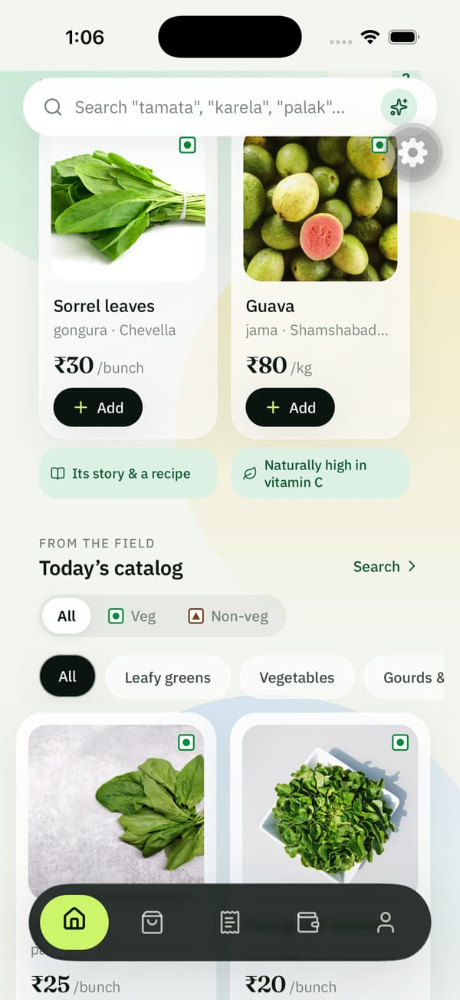                                   | 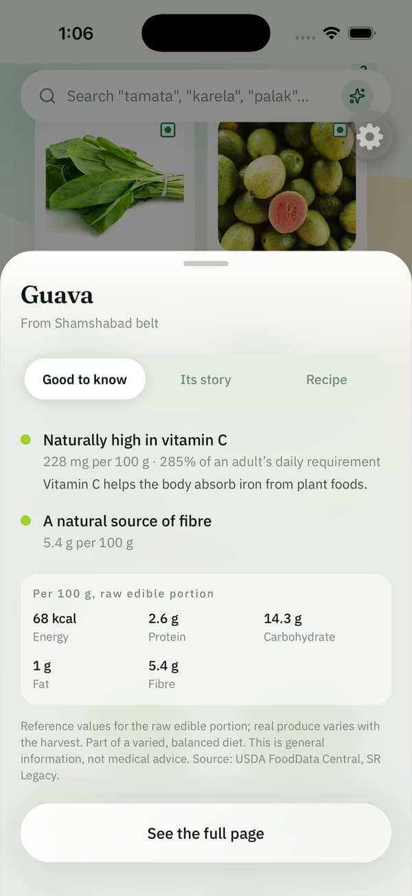                               |
| **In season now.** Each card carries the veg mark and a "good to know" strip. | **Tap it.** The statements, the figures behind them, the source.                    |
| 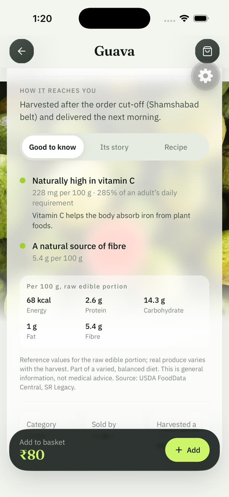                             | 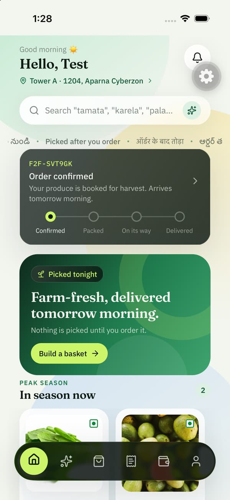                                |
| **Product page.** Good to know · Its story · Recipe.                          | **Home, with an order on its way.** New — an iPhone previously showed nothing here. |
| 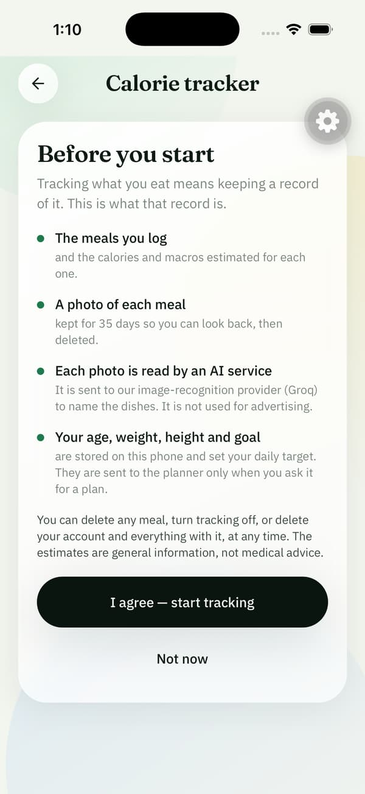                               | 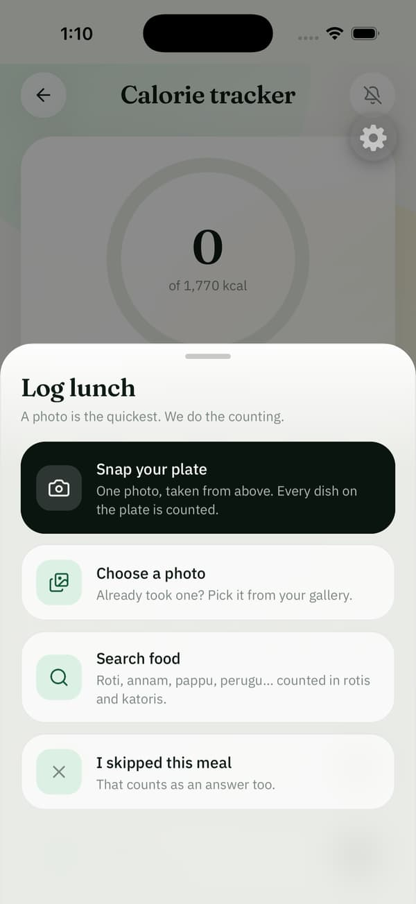                                       |
| **Before tracking starts.** What is kept, for how long, who reads the photo.  | **Log a meal.** Photo, gallery, search, or "skipped".                               |
| 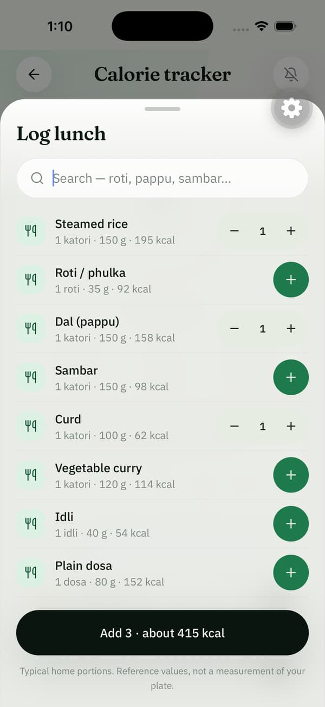                                       | 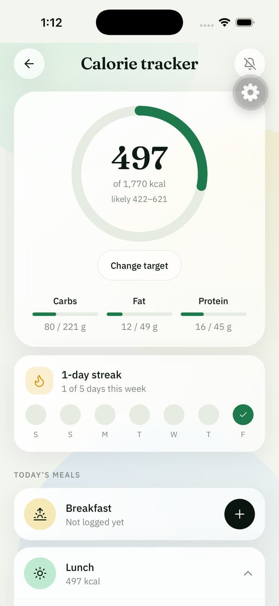                           |
| **Search food** in rotis and katoris, by the names used at home.              | **After a photo.** A number, and the honest range around it.                        |
| 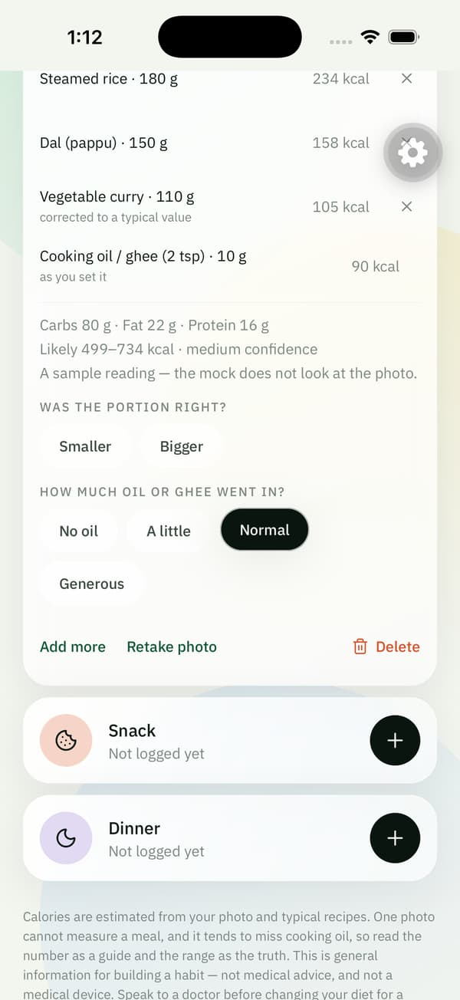                        | 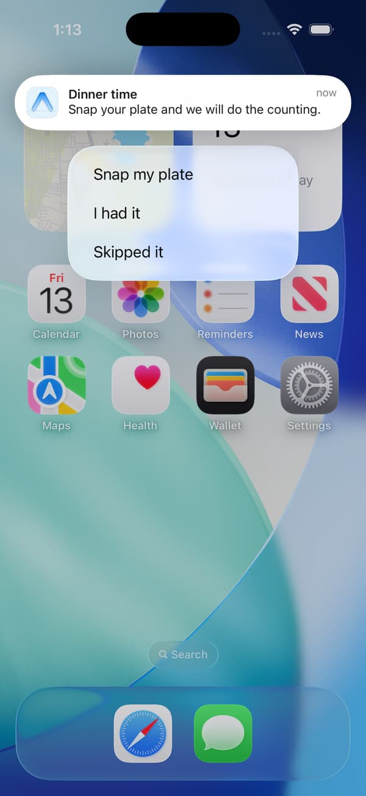                                 |
| **Correcting it.** Portion, and the oil a photo cannot see.                   | **Meal-time reminder** with its three buttons, on a real iOS notification.          |
| 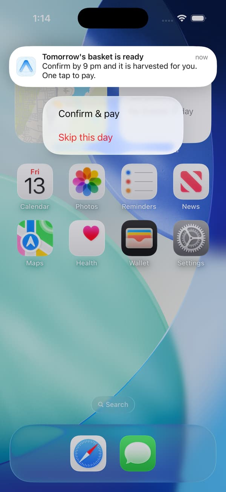                             | 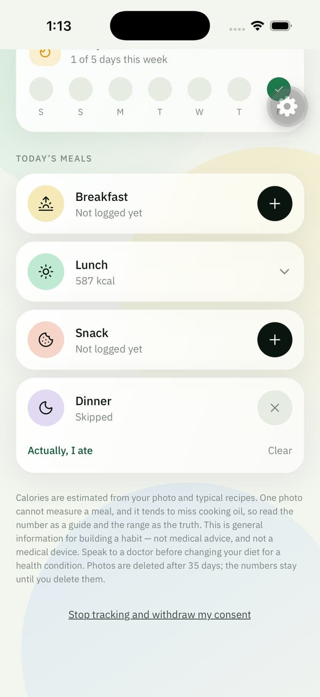                               |
| **The evening before.** Confirm & pay, or skip the day.                       | **"Skipped it"** pressed on the reminder — the app opened with dinner marked.       |

### Editing a product's page from the admin website

|                                                                                                                                                    |                                                                                          |
| -------------------------------------------------------------------------------------------------------------------------------------------------- | ---------------------------------------------------------------------------------------- |
| 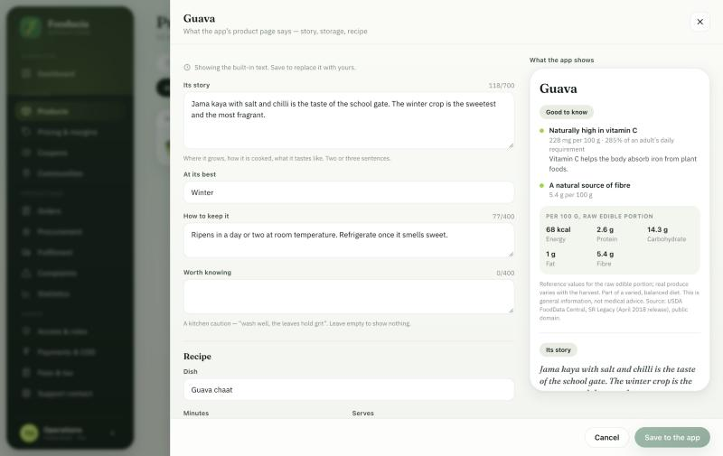                                                                                                          | 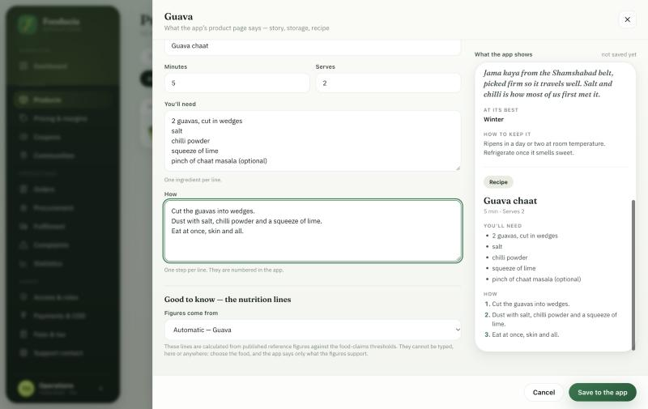                                       |
| **Admin → Products → book icon.** The form on the left; on the right, the page as the phone will draw it — the server's own answer, not a mock-up. | **Recipe**: one ingredient per line, one step per line. The preview follows as you type. |
| 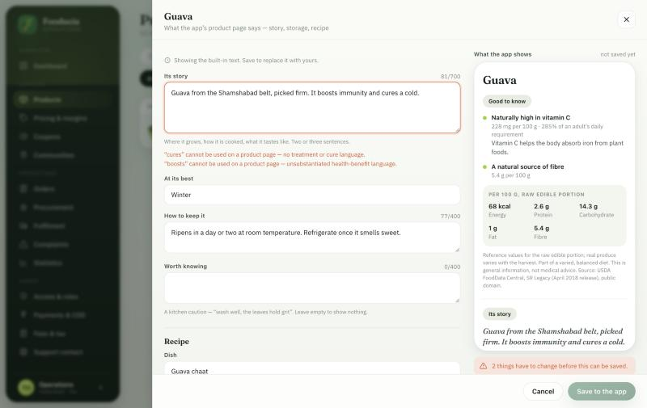                                                                                       | 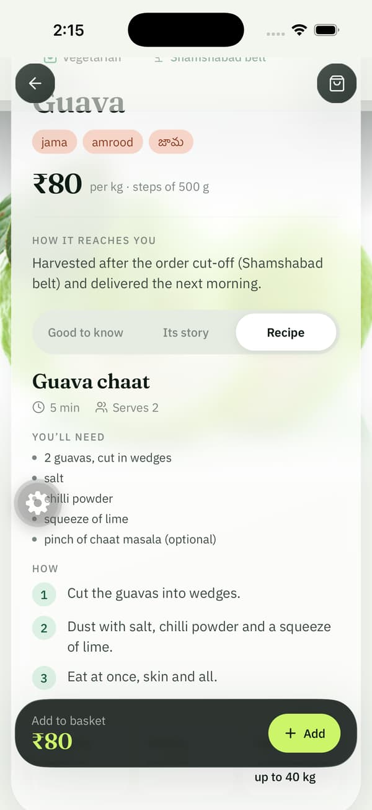                                           |
| **Wording the food rules forbid is refused**, with the phrase named, and Save stays off until it is fixed.                                         | **The app, a moment later**, showing the three steps typed in the editor above.          |

How it behaves:

- **You edit the words**: its story, when it is at its best, how to keep it, a caution, and a recipe. What you save replaces the built-in text for that product, whole. "Reset to built-in text" takes it back.
- **You do not edit the nutrition lines.** "Naturally high in vitamin C" is calculated from reference figures. You choose which food the figures come from, or switch the lines off for a product — nobody types one.
- **The same wording check as the built-in text** runs on every save. "Boosts immunity", "cures", "healthy", "organic", disease names and the rest are refused with the reason, in plain words.
- **Every save is recorded** in the audit trail with who made it and what it replaced.
- **The app shows a change within about a minute.** No app update is needed for an edit.
- A product with nothing written (anything new you add) can be given a page from scratch.

---

## 3. Why the calorie tracker is not switched on for customers

It works. It is not on, for three reasons, each of which is yours to clear:

1. **The numbers have not been checked by anyone qualified.** The dish table (27 cooked Indian dishes) is drawn from the Indian Nutrient Databank. Its figures are computed from recipes, not measured, and one photograph cannot measure a meal — published tests put photo apps about a third low, mostly on hidden oil. The app answers that with ranges, an oil question and plain wording, but a nutrition professional should look at the table and the wording before a customer relies on it.
2. **Consent is recorded on the phone, not on the server.** The customer agrees on a screen that says what is kept. The Digital Personal Data Protection Act wants you to be able to _show_ that consent later. That needs one small table and one endpoint (listed in §5).
3. **The licence for the dish data is unconfirmed.** The paper is CC BY 4.0; the data repository itself carries no licence file. One email to the authors settles it.

Until then it is visible only to a super-admin phone number, enforced on the server, exactly as the meal planner already was.

**The product information is different and is on for everyone.** Its statements are computed from United States Department of Agriculture reference data (public domain) against FSSAI's own thresholds, never typed by hand, and a test fails the build if banned wording appears anywhere in the content.

---

## 4. Live Activities — what is real today, and what needs a build

You asked for what Rapido and Zomato do. There are two different things under that name:

**What ships with an over-the-air update (built):**

- One order notification that **replaces itself** as the order moves, with a progress line (`●●○○`), instead of a pile of separate alerts.
- **Buttons on the notification**: Snap my plate / I had it / Skipped it; Confirm & pay / Skip this day; View order / Something wrong?
- A **live order card on the Home screen**, on both iPhone and Android.
- On Android, a pinned "live order" notification that stays in the shade until delivery (this already existed).

**What needs a new store build (not built):**

|             | iPhone                                                                          | Android                                                                    |
| ----------- | ------------------------------------------------------------------------------- | -------------------------------------------------------------------------- |
| The feature | Live Activity on the lock screen and Dynamic Island                             | "Live Updates" progress notification (Android 16)                          |
| Needs       | `expo-widgets`, a paid Apple Developer account, an APNs key (.p8) on the server | A native module (Voltra or our own), the promoted-notifications permission |
| Why not now | No Apple Developer account yet; and the Android build is in review              | Same build constraint                                                      |

One limit is permanent and worth knowing: **a notification button cannot place an order by itself.** Indian consumer rules require the price in view and an explicit act of consent, and payment rules forbid a debit the customer did not see. So "Confirm & pay" opens the confirm screen with the amount on it and one button — one tap more than a pure notification purchase, and the reason it is lawful.

---

## 5. What is not built

Listed so nothing is assumed:

- **Plans stored on the server.** Meal plans live on the phone. A new phone, or a reinstall, loses them. Needs a `MealPlan` table, three endpoints, and a sync.
- **Server-side consent log** for meal tracking (§3).
- **True Live Activities / Live Updates** (§4).
- **Barcode scan**, **Apple Health / Health Connect sync**, **weekly shopping-list tab** from the BetterMe screens. None is needed for the first release of the tracker; barcode needs a packaged-food database we do not have.
- **Hindi and Telugu versions of the product stories and recipes.** The app's interface is in three languages; this content is in English only.
- **Rating an order** from the "delivered" notification — it opens the order; there is no star screen yet.

---

## 6. How it ships — order matters

The app talks to new server routes. If the app update goes out first, the tracker and the product information call routes that do not exist yet.

1. **Wait for Play approval.** You chose this earlier for anything risky; it still holds.
2. **Commit and push** (I have not — say the word).
3. **Create the `ProductKnowledge` table on the production database.** One statement, safe to run more than once, and it touches nothing else:

   ```sql
   CREATE TABLE IF NOT EXISTS "ProductKnowledge" (
     "productId" TEXT PRIMARY KEY,
     "data"      JSONB NOT NULL,
     "updatedBy" TEXT,
     "updatedAt" TIMESTAMP(3) NOT NULL DEFAULT CURRENT_TIMESTAMP
   );
   ```

   Use this statement, not `prisma db push` — the persistence code warns that `db push` drops columns the schema does not carry. Until the table exists the shop is unaffected (product pages show the built-in text) and the editor says, in words, that it cannot save yet. It notices the table by itself once it is there; no restart.

4. **Create the `MealLog` table on the production database, if it is not there yet.** This has been on your list since October (the first meal check-in release). The table's columns have not changed in this work. Create it with SQL written from `apps/api/prisma/schema.prisma` rather than `db push`, for the reason above. Without it the tracker runs but forgets: logs live in memory and vanish on a restart — and a streak that resets itself overnight is worse than no streak.
5. **Promote the API on Render.** New routes: product knowledge (public and admin), meal logging, streak, food search.
6. **The admin website** deploys itself from the same push (Vercel). Its editor needs step 5 to be live.
7. **Then** publish the over-the-air update to the app.
8. Optional, before step 7: set `EXPO_PUBLIC_FSSAI_LICENCE` in the EAS environment (see the register).

Nothing in this work needs a new store build. The camera and photo permission wording in `app.json` was updated to mention meal logging; that only takes effect at the next build and changes nothing until then.

---

## 7. Evidence

| Check                                          | Result                                                                                                                                                                                                                                                  |
| ---------------------------------------------- | ------------------------------------------------------------------------------------------------------------------------------------------------------------------------------------------------------------------------------------------------------- |
| API tests                                      | 513 passing (70 files) — 21 new for the admin editor. One unrelated test fails at random in roughly half of full runs and passes on a rerun (a different test each time; a known flake in this suite, not caused by this work)                          |
| App tests                                      | 98 passing (13 files) — 18 new                                                                                                                                                                                                                          |
| App lint                                       | 0 errors                                                                                                                                                                                                                                                |
| App type errors                                | 54, all pre-existing (was 65 at the start of this work)                                                                                                                                                                                                 |
| On an iPhone simulator, by hand                | Sign-up → address → shop → product page → seasonal sheet → basket → checkout → simulated payment → order tracking → Home live card; tracker consent → log by search → log by photo → oil correction → streak; both notification types and their buttons |
| Admin editor, in a browser against a local API | Open → type forbidden wording → refused with the phrase named → correct it → edit the recipe → save → the app-facing route returns the new text                                                                                                         |
| Admin edit → phone, for real                   | The simulator app, pointed at that same local API, signed in and showed the three recipe steps typed in the editor                                                                                                                                      |

**Not verified:** the admin editor against the production database (the table does not exist there yet); anything on a real Android phone; the real photo model (the simulator ran against a stand-in that always returns the same plate); real push delivery through Expo; the staff screens.

**Found along the way, and fixed** — details in [ui-audit.md](ui-audit.md):

- React Native 0.86 removed an API three screens were using. Result: the "Signing you in…" cover became a strip that shoved the whole app up the screen, and the delivery rider's hand-over sheet lost its backdrop and sat at the top of the screen. Both are in the build that is live now.
- The checkout screen stated two different cancellation rules a few lines apart. The server enforces one of them; the other was stale.
- The CI pipeline had failed on every push for weeks, in its setup step, before running a single test. Fixed in `.github/workflows/ci.yml`, uncommitted.
