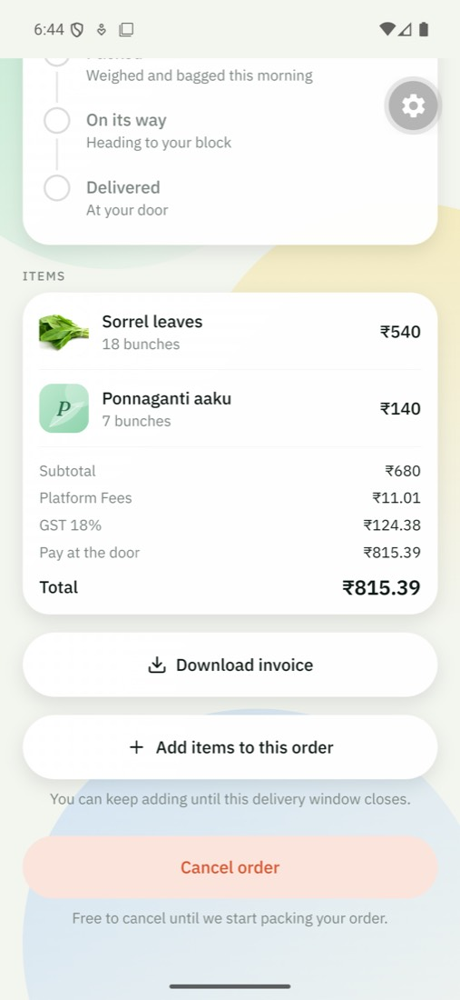
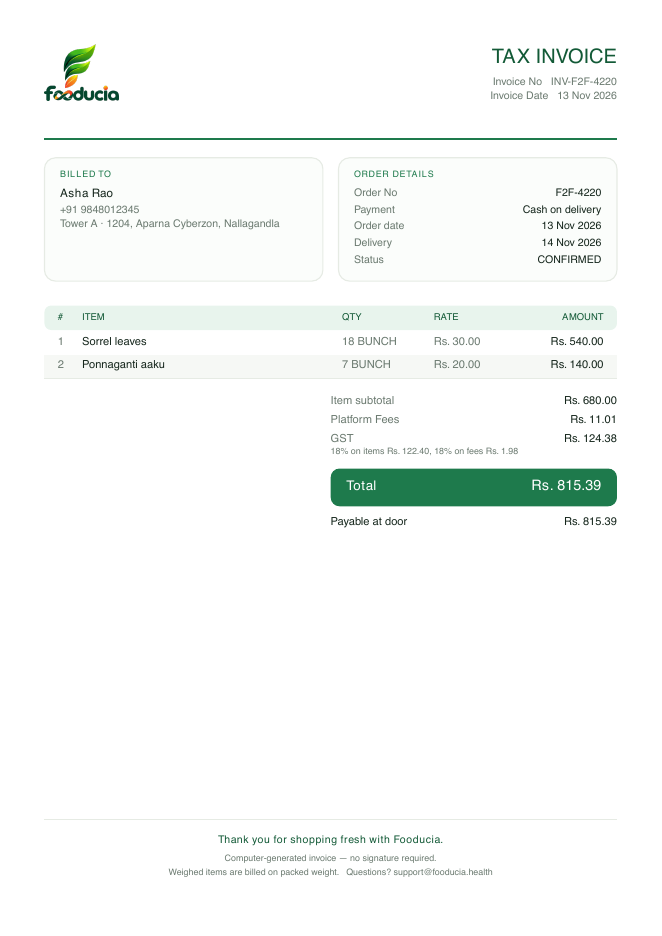
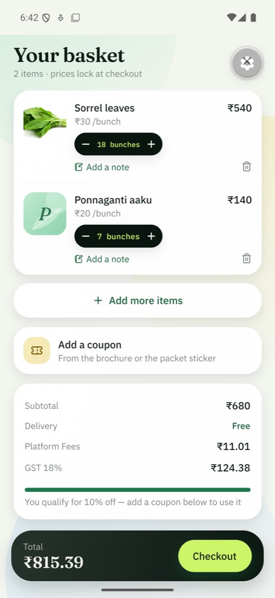
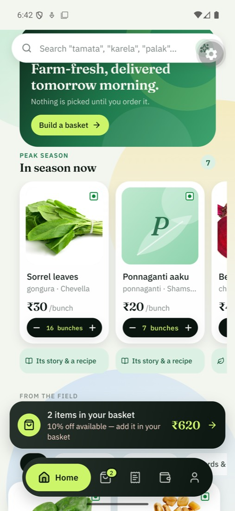
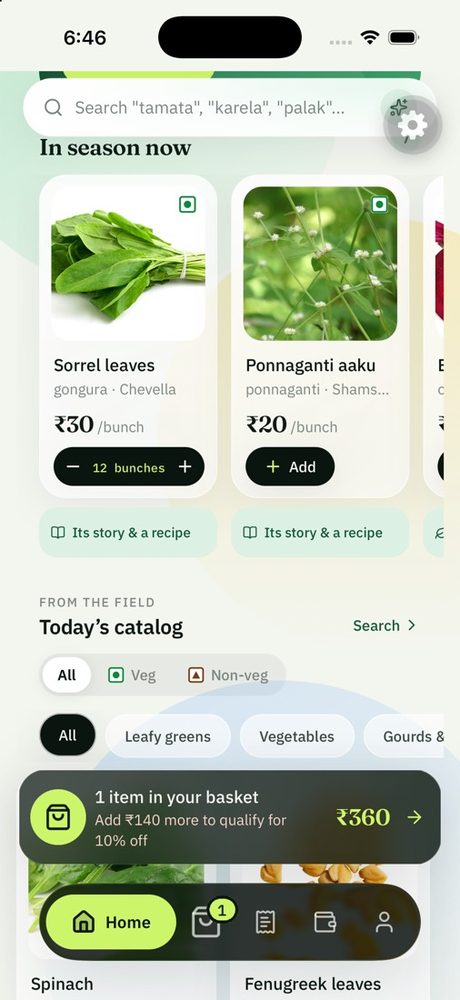
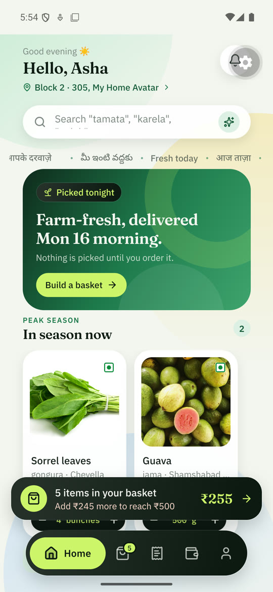
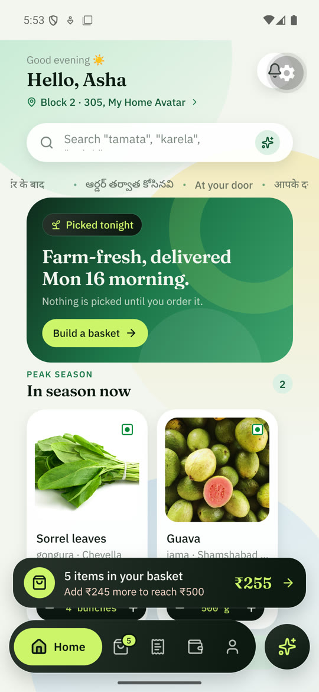

# UI audit — customer app

13 November 2026. Done by walking the app on an iPhone 17 Pro simulator (iOS 26.5) running this working tree against the in-app mock server, and reading the code behind anything that looked wrong.

**What was walked:** welcome → phone → code → address → Home → search → product page → seasonal sheet → basket → checkout → simulated payment → order confirmation → order tracking → Orders → Wallet → Profile → Meal planner → Meal calendar → Calorie tracker (consent, log by search, log by photo, corrections, streak) → plan-confirm screen → both notification types and their buttons. In the admin website: Products and the new product-page editor only.

**What was not:** any Android device; the notification centre; coupons; address editing; the report-a-problem flow; every staff screen; Hindi and Telugu layouts; large text sizes; VoiceOver itself (labels were added and read in code, not listened to). Treat those as unaudited, not as passed.

---

## Fixed

### Faults a customer would have seen

| #   | Where                               | What was wrong                                                                                                                                                                                                                                                 | Fix                                                                                                                                                                                                  |
| --- | ----------------------------------- | -------------------------------------------------------------------------------------------------------------------------------------------------------------------------------------------------------------------------------------------------------------- | ---------------------------------------------------------------------------------------------------------------------------------------------------------------------------------------------------- |
| 1   | Every launch, signed in             | The "Signing you in…" cover laid out as a strip _under_ the app and pushed the tab bar a fifth of the way up the screen. Cause: React Native 0.86 removed `StyleSheet.absoluteFillObject`; spreading it silently added nothing. **This is in the live build.** | Positioned explicitly. The cover now also lifts itself after six seconds, so a weak signal shows the shop rather than a spinner for up to two minutes.                                               |
| 2   | Rider's hand-over sheet (staff)     | Same cause: no dimmed backdrop, the card at the top of the screen instead of the bottom, tapping outside did not close it. **Also in the live build.**                                                                                                         | Positioned explicitly. Not seen on a device — verify on a rider's phone.                                                                                                                             |
| 3   | Product page, scrolled              | The small title in the bar appeared while the large product name was still sliding under it: the name printed twice, overlapping. Further down, page text ran, sharp, straight through the title — the frosted bar does not blur while it is fading.           | The bar is solid; the small title waits until the large one has gone, measured rather than guessed. [Before](screens/before-product-header-overlap.jpg) · [after](screens/product-good-to-know.jpg). |
| 4   | Checkout                            | Two cancellation rules on one screen: "until we start packing" and "until the evening before your window".                                                                                                                                                     | The server enforces the first. The second corrected, in three languages.                                                                                                                             |
| 5   | Plan-confirm screen                 | Opened for a day with nothing planned, it showed "0 meals · 0 products" above a live **Confirm order ₹0** button.                                                                                                                                              | An honest empty state with two ways forward; no pay bar.                                                                                                                                             |
| 6   | Plan-confirm screen                 | Opened from an old reminder for a day already past, it offered the "nearest window" — quietly turning last month's plan into this week's order.                                                                                                                | "This day has passed." Nothing to confirm.                                                                                                                                                           |
| 7   | Plan-confirm screen                 | The pay bar showed only what was left after the wallet, so a fully covered order read "₹0 · Covered by wallet". A day under the ₹500 minimum was accepted, then refused by the server.                                                                         | The bar shows the order total, where the money comes from, and a button that names the charge ("Pay ₹146"). Under the minimum it says so, with the gap, and opens the basket.                        |
| 8   | Welcome screen                      | Clock and battery in dark text on the night sky — invisible.                                                                                                                                                                                                   | Light status bar on that screen.                                                                                                                                                                     |
| 9   | Order confirmed ("Locked in.")      | A pale strip across the top of a dark screen, with dark status text on it.                                                                                                                                                                                     | Strip removed there; light status bar.                                                                                                                                                               |
| 10  | Code entry                          | For a beat after the code was accepted the line read "Sent to +91 ."                                                                                                                                                                                           | Keeps showing the number.                                                                                                                                                                            |
| 11  | Home                                | An order, once placed, vanished from the first screen. On an iPhone nothing anywhere outside Orders showed it.                                                                                                                                                 | Live order card: number, status, what happens next, arrival, a four-stop track. [Screenshot](screens/home-live-order-card.jpg).                                                                      |
| 12  | Reminder "Confirm tomorrow's order" | Tapping it opened the app and went nowhere.                                                                                                                                                                                                                    | Routes to the confirm screen, from a running app and from a cold start.                                                                                                                              |
| 13  | Account deletion                    | Meal logs, meal photos and notifications were left behind.                                                                                                                                                                                                     | Deleted with the account.                                                                                                                                                                            |

### Wording

| #   | Where                     | Was                                                                                                                           | Now                                                                                       |
| --- | ------------------------- | ----------------------------------------------------------------------------------------------------------------------------- | ----------------------------------------------------------------------------------------- |
| 14  | Home rail vs. banner      | "Picked this morning" directly above "Picked tonight"                                                                         | Rail: "Picked after you order" (true either way). **The banner still needs your answer.** |
| 15  | Home banner               | "Farm-fresh, delivered **T**omorrow morning."                                                                                 | "…delivered tomorrow morning."                                                            |
| 16  | Home banner, product page | "never from a cold room"; "never waxed"                                                                                       | What Fooducia does, nothing about anyone else's food.                                     |
| 17  | Product page              | "Daily cap · 50" — our own operations term                                                                                    | "Harvested a day · up to 50"                                                              |
| 18  | Welcome                   | "Vegetables, greens and **meat harvested** after you order"                                                                   | "…harvested after you order, meat cut that morning"                                       |
| 19  | Planner                   | "Your dietitian" — a protected professional title                                                                             | "Meal planner"                                                                            |
| 20  | Checkout, wallet row      | "No balance yet. Everything goes…" — cut off before saying where                                                              | Wraps to two lines                                                                        |
| 21  | Tracker                   | "Retake photo" on a meal that was never photographed                                                                          | "Use a photo instead"                                                                     |
| 22  | Tracker                   | Asked "how much oil went in?" of foods picked from the list, whose figures already include a recipe's oil — counting it twice | Asked of photos only                                                                      |

### Consistency and reach

| #   | What                                                                                                                                                                                             | Fix                                                                 |
| --- | ------------------------------------------------------------------------------------------------------------------------------------------------------------------------------------------------ | ------------------------------------------------------------------- |
| 23  | The veg / non-veg filter drew its own marks — a red dot for non-veg — while the cards used the prescribed brown triangle                                                                         | One component draws every mark                                      |
| 24  | Filter chips 31 points tall; "remove item" 36                                                                                                                                                    | 44-point reach on both                                              |
| 25  | Tracker item rows: one row's note sat against the next row's name                                                                                                                                | Spaced                                                              |
| 26  | Tracker: "Delete" rode higher than the two links beside it                                                                                                                                       | Aligned                                                             |
| 27  | A notification button pressed while already on that screen stacked a second copy                                                                                                                 | Replaces instead                                                    |
| 28  | Every screen re-rendered its route guard on every store update — basket taps included — because the role selector built a new object each time                                                   | Memoised                                                            |
| 29  | My own fix for item 8 leaked: the welcome screen stays mounted under the screens pushed over it, so its light status text carried on to the pale phone-number screen, where it could not be read | Light only while that screen is in focus. Seen fixed on the device. |
| 30  | Recipes: a recipe saved without minutes or servings would have read "null min · Serves null"; two identical ingredient lines shared a key                                                        | Both optional and both handled, now that staff can write recipes    |

---

## Open — needs a decision or a device

| #   | Where                               | What                                                                                                                                                                                               | Whose                                                |
| --- | ----------------------------------- | -------------------------------------------------------------------------------------------------------------------------------------------------------------------------------------------------- | ---------------------------------------------------- |
| A   | Home banner, welcome screen         | "Picked tonight." Is it? Or at dawn? One answer, used everywhere, including the launch film.                                                                                                       | **Yours**                                            |
| B   | Checkout                            | Pressing Pay before ticking the terms box shows a brief message at the top while the box is two screens below. It should scroll to the box.                                                        | Small; next pass                                     |
| C   | Address form                        | The on-screen keyboard covers the field being typed in; the form does not scroll it into view. Seen on the simulator — confirm on a phone.                                                         | Next pass                                            |
| D   | Block picker                        | A sheet two-thirds of the screen tall holding eight small chips.                                                                                                                                   | Cosmetic                                             |
| E   | Meal calendar                       | An AI plan title is cut mid-word: "7-Day Weight Loss Meal Plan (South India". And "Weight Loss" in a title is the kind of claim the content check exists to stop — it does not yet read AI output. | Before the planner opens to customers                |
| F   | Profile                             | "vegetarian + eggs" in lower case where every other value is capitalised.                                                                                                                          | Cosmetic                                             |
| F2  | Profile → Preferences               | "Packed, out for delivery, wal…" — the sentence is cut off.                                                                                                                                        | Cosmetic; next pass                                  |
| G   | Product page, mid-scroll            | The floating Back button passes over the "Vegetarian" pill for a moment.                                                                                                                           | Cosmetic                                             |
| H   | Catalogue data (live, seen earlier) | Spinach at ₹57.2 a bunch; a Telugu alias for bathua that reads as a different vegetable; a Telugu name for dill that looks wrong. These are data, edited in the admin console, not code.           | **Yours** — a Telugu reader should check the aliases |
| I   | Mock catalogue                      | Spinach has no photograph. Mock data only; customers never see it.                                                                                                                                 | —                                                    |

---

## A note on the audit itself

Two things that looked like faults were not, and are recorded so nobody chases them:

- The Basket button on the product page appeared dead. It was the development build's floating tools button, which swallows taps around itself. With it dragged away the button works.
- "Pay & place order" appeared dead. It was refusing, correctly, because the terms box was not ticked (item B is about making that refusal easier to understand).

---

## Second pass — Android and iPhone, 13 November

Started from an owner's report on a real Android phone: "boxes" at the borders of every card, worst while screens animate in. This pass was done on an **Android 16 emulator** (a local development build of this working tree) and the **iPhone 17 Pro simulator**, side by side, against the in-app mock server — and then once more against a local copy of the real API with the admin website, to prove the location feature end to end. Screenshots and clips are in [screens/pass-2](screens/pass-2/).

**What was walked on both:** sign-in → address → Home → catalogue grid → product page → basket → Orders → Wallet → Notifications → Profile → add / edit / remove an address → "Use my location" (inside a community, outside one, permission refused) → "tell me when you deliver here". In the admin website: Communities (location editor) and the new Demand section.

**Still not walked:** a physical Android phone, a physical iPhone, checkout and payment on Android, staff screens, Hindi and Telugu layouts, large text sizes, VoiceOver / TalkBack.

### Fixed — Android

| #   | Where                      | What was wrong                                                                                                                                                                                                                                                                                                                                                                     | Fix                                                                                                                                                                                                                                   |
| --- | -------------------------- | ---------------------------------------------------------------------------------------------------------------------------------------------------------------------------------------------------------------------------------------------------------------------------------------------------------------------------------------------------------------------------------- | ------------------------------------------------------------------------------------------------------------------------------------------------------------------------------------------------------------------------------------- |
| 31  | Every card, button and bar | **The boxes.** Android draws an `elevation` shadow _underneath_ the whole view. Every card here is slightly see-through, so the shadow showed through it as a darker frame around a lighter, square-cornered box — and far more while a card was fading in. [Before](screens/pass-2/android-fade-box-before.jpg) · [before / after](screens/pass-2/android-card-before-after.jpg). | Shadows on Android are now drawn outside the card's outline only (`boxShadow`), so there is nothing underneath to show through. One place defines it for the whole app. Needs Android 9; older phones get a flat card. iOS unchanged. |
| 32  | Sold-out photos            | The same artefact inside the photo: a pale square inset in every sold-out picture, from the veil's own elevation.                                                                                                                                                                                                                                                                  | The veil keeps its paint order and casts no shadow.                                                                                                                                                                                   |
| 33  | Every bottom sheet         | Sheets were see-through: field labels and the Save button of the screen below were readable between the community names. iOS blurs what is behind a sheet; Android cannot.                                                                                                                                                                                                         | Solid on Android.                                                                                                                                                                                                                     |
| 34  | Tab bar, basket bar        | Product names and "Add" buttons ghosted through the dark bars as they scrolled underneath.                                                                                                                                                                                                                                                                                         | Solid on Android.                                                                                                                                                                                                                     |

### Fixed — both platforms

| #   | Where                       | What was wrong                                                                                                                                                                                              | Fix                                                                                                                                                                                                                        |
| --- | --------------------------- | ----------------------------------------------------------------------------------------------------------------------------------------------------------------------------------------------------------- | -------------------------------------------------------------------------------------------------------------------------------------------------------------------------------------------------------------------------- |
| 35  | Profile → addresses         | An address could not be edited or removed. Tapping a card only ever set the default.                                                                                                                        | Each address has **Edit**, **Remove** and (when it is not the default) **Make default**. The last address cannot be removed; removing the default hands it on. [Screenshot](screens/pass-2/android-profile-addresses.jpg). |
| 36  | Address form                | Only some fields turned red. Community and Block showed loose red text with no outline; Flat showed an outline.                                                                                             | Every missing field gets the same red outline, red label and message, and the form scrolls to the first one. [Screenshot](screens/pass-2/android-address-validation.jpg).                                                  |
| 37  | Address form                | Floor was optional, and refused 0 — so a ground-floor resident could only leave it blank.                                                                                                                   | Floor is required; 0 is the ground floor and the field says so. (The server still accepts no floor, for the app builds already on phones.)                                                                                 |
| 38  | Address form                | The keyboard covered the field being typed in (item C above).                                                                                                                                               | Focusing a field scrolls it clear of the keyboard. Seen on the iPhone simulator; the emulator has no on-screen keyboard to check against.                                                                                  |
| 39  | Address form, Save button   | A hard-edged box around the button's shadow: the scroll area stopped at the page gutter and cut every shadow that reached it.                                                                               | The scroll area runs to the screen edge.                                                                                                                                                                                   |
| 40  | "Use my location"           | It could never recognise a real community: it compared against three coordinates hard-coded for the demo data. Every customer was told "we don't deliver here yet — we've noted it", and nothing was noted. | See "Location" below.                                                                                                                                                                                                      |
| 41  | Any sheet with a text field | On iPhone the keyboard rose over the field and the button under it; the sheet did not move.                                                                                                                 | Fields inside a sheet are now the sheet's own kind, which it lifts for. [Screenshot](screens/pass-2/ios-request-sheet-keyboard.jpg).                                                                                       |
| 42  | Block picker                | Two thirds of the screen for eight chips (item D above).                                                                                                                                                    | Sized to its contents.                                                                                                                                                                                                     |
| 43  | Profile → Preferences       | "Packed, out for delivery, wal…" (item F2 above).                                                                                                                                                           | Two lines.                                                                                                                                                                                                                 |
| 44  | Profile                     | "vegetarian + eggs" in lower case (item F above).                                                                                                                                                           | Capitalised like every other value.                                                                                                                                                                                        |
| 45  | Notifications               | Tapping anything that was not about an order did nothing.                                                                                                                                                   | One routing table for every notification, in the list and in the system shade.                                                                                                                                             |

### New — motion

Adding a product now sends its photo into the basket: it lifts off the card, arcs down into the basket bar (or up into the basket button on a product page), and the basket bounces when it lands. The quantity figure ticks up or down instead of being replaced. With the phone's "reduce motion" setting on, nothing flies; the basket still acknowledges the add. Clips: [Android](screens/pass-2/add-to-basket-android.gif) · [iPhone](screens/pass-2/add-to-basket-ios.gif).

### New — location

- **Recognising a community.** Each community has a pin and a radius, set in the admin website (Communities → Location). The app is handed those and does the comparison **on the phone**; where the customer is standing is not sent anywhere to find out. [Recognised](screens/pass-2/ios-location-recognised.jpg).
- **Outside every community.** The app names the area using the phone's own place lookup and counts one anonymous request for it — a rounded area, no name, no number. [Screenshot](screens/pass-2/ios-location-not-served.jpg).
- **"Tell me when you deliver here."** A separate, deliberate tap. Only this attaches an account to a place, and the sheet says what is kept before the button is pressed. Also reachable from "My community isn't listed" without sharing a location. The request is listed in Profile, where it can be removed.
- **Admin → Demand.** Areas ranked by people waiting, then by anonymous checks; the community names people typed; the nearest community already served; and a "notify" action with a confirm step. [List](screens/pass-2/admin-demand.jpg) · [one area](screens/pass-2/admin-demand-area.jpg) · [notify](screens/pass-2/admin-demand-notify.jpg).
- Proved end to end on a local copy of the real API: a location check on the phone appeared in Demand; a subscription appeared with its typed community; "notify" delivered an in-app notification; tapping it opened the add-address screen.

Two cases where the app deliberately does **not** count a request: when any community still has no pin on record (a miss proves nothing), and when the phone's fix is vague — Android lets a customer share an "approximate" location, good to a couple of kilometres.

### Open after this pass

| #          | Where                     | What                                                                                                                                                                                                                         | Whose                                    |
| ---------- | ------------------------- | ---------------------------------------------------------------------------------------------------------------------------------------------------------------------------------------------------------------------------- | ---------------------------------------- |
| J          | Everything in this pass   | Seen on an emulator and a simulator, not on a phone. The owner's Xiaomi showed the boxes more strongly than the emulator did; it is the phone to confirm the fix on.                                                         | **Yours**, after the update is installed |
| K          | Communities               | No community in production has a pin yet. Until each one does, "Use my location" will say it could not place the customer, and nothing is counted.                                                                           | **Yours** — Communities → Edit location  |
| L          | Numeric keyboards, iPhone | The "Done" bar above the number pad did not appear on the iOS 27 simulator. Tapping outside a field still dismisses the keyboard. Not caused by this pass as far as could be told; check on a real iPhone.                   | Next pass                                |
| M          | Development build only    | A console error at cold start ("state update on a component that hasn't mounted yet") from the router when the app is opened by a development link. Not seen to affect anything; not present in a store build's launch path. | —                                        |
| N          | Hindi and Telugu          | The new profile strings (edit, remove, floor, requests) are translated but, like the rest, not reviewed by a native speaker. The address form and request sheet are English only, as before.                                 | **Yours**                                |
| B, E, G, H | (from the first pass)     | Unchanged.                                                                                                                                                                                                                   |                                          |

### New — Customers (admin website, added 13 November)

A new section, **Customers**, answers "is this their first order, their second, or their twentieth?" for every customer.

- **The list:** everyone who has ordered, where they stand (1st order / 2nd order / n orders), how many were delivered, first and latest order, and what they have spent on delivered orders — with a count of customers at each stage and the share who came back.
- **One customer:** their orders, numbered in the order they were placed, newest first, with what was in each and what became of it.
- **On the Orders list:** each order now says which of the customer's orders it is. The "New" badge follows the same count, so it lands on the first order that was really placed — it used to skip a customer whose first payment had failed.
- **What counts as an order:** one that was placed. An abandoned checkout or a failed payment takes no number; an order cancelled after it was placed keeps its number.
- **Built to the DPDP Act:** admins only; a masked number in the list and no address; the full number shown only for a stated reason; every history opened and every number shown is recorded; no export; a deleted account keeps its orders and loses its name and number. Detail in the [compliance register](india-compliance-register.md) §4.

Nothing new is stored and no database change is needed for this section.

## Third pass — tab bar, quick taps, and the bill, 13 November

Reported by the owner from a phone on the Play build: basket photos showing a letter instead of the picture, taps "not responding as expected" under heavier use, and an order of ₹602.99 on a ₹500 basket with nothing between the subtotal and the total — in the app and on the invoice — although a platform fee and GST had been set in the console.

### Fixed — the bill

- **The fee and tax lines of an order were never saved.** They were worked out on every order and kept in memory only, so they were gone at the next restart of the server. They are now written with the order.
- **The order the app receives did not carry them.** It now does, in the same shape the basket uses, so a placed order prints the rows it was quoted with: each fee by the name given in the console, then the tax with what it is a percentage of ("GST 18%", "GST 18% on fees").
- **Shown in:** the app's order screen and shared receipt, the invoice (with the working: "18% on items Rs. 122.40, 18% on fees Rs. 1.98"), and the order drawer on the admin website. Basket and checkout already showed them; the tax row there now names its rate too.
- **The invoice printed the delivery fee twice** when an order had its lines. One function now produces the lines for every place a bill is shown.
- **Orders already saved without their lines:** where the saved fee and tax settings give an order its own total to the paisa, the lines are put back at start-up and marked as recovered. Where they do not (the settings have changed since), the bill shows the difference as one line, "Fees and taxes", so it adds up.

### Fixed — basket photos

The basket sent each photo's storage address; every other screen sends it through the app's own image route. The basket now gives the same address the catalogue does, so the photo is already on the phone by the time the basket opens.

### Fixed — quick taps

Measured on the Android emulator before the change: 6 fast taps on "+" counted as 5; 5 alternating taps on two products counted as 3 and 4. After: 10 of 10, 6 and 6 of 6 and 6, and a mixed run of minus and plus exact — on screen and on the server.

- **Two taps before the screen redrew both counted up from the same number.** Each tap now counts from the last tap.
- **The "+" moved.** The stepper grew with its label ("1 bunch", "2 bunches", "10 bunches"), sliding the button along under the thumb, and past ten it ran off the edge of a product card. The figure now sits in a box of fixed width and shrinks to fit.
- **A late reply from the server could undo a tap,** and **a quantity could show on a product that was never touched** after a fast scroll, because the figure was kept by the card and the grid reuses its cards. The figure is now kept by product, one request at a time per product, and held briefly after it is saved.
- **Every card redrew on every change to the basket.** A card now redraws only when its own line changes.
- One photo flies to the basket per burst of taps rather than one per tap.

### Changed — tab bar

The current tab is a pill with its icon and name; the others are icons. Colours unchanged. For staff with the planner, it is a separate round button to the right of the bar.

### Open after this pass

- **GST on items is set to 18% in the console.** Fresh vegetables, fruit and meat are nil-rated; at 18% a ₹500 basket carries ₹90 of tax on the produce itself. The app charges and prints whatever is set — the rate is the owner's (and their accountant's) to confirm.
- **The invoice is titled "Tax invoice".** A GST tax invoice also needs the seller's GSTIN, and HSN/SAC codes per line. The GSTIN prints once `SELLER_GSTIN` is set on the server; HSN codes are not built.
- Fast taps were measured on an emulator and an iPhone simulator, not on the owner's phone.
